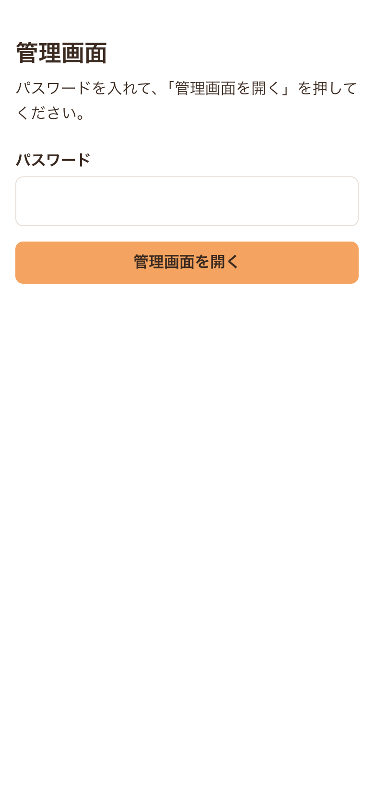
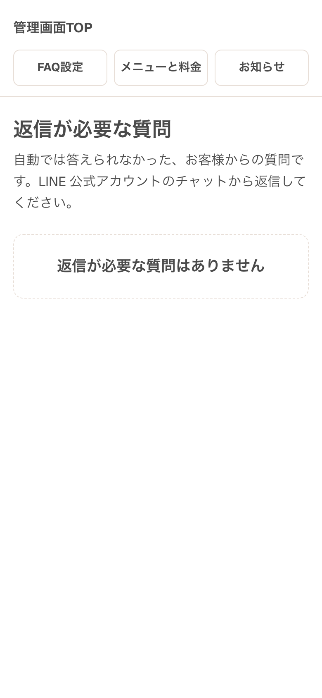
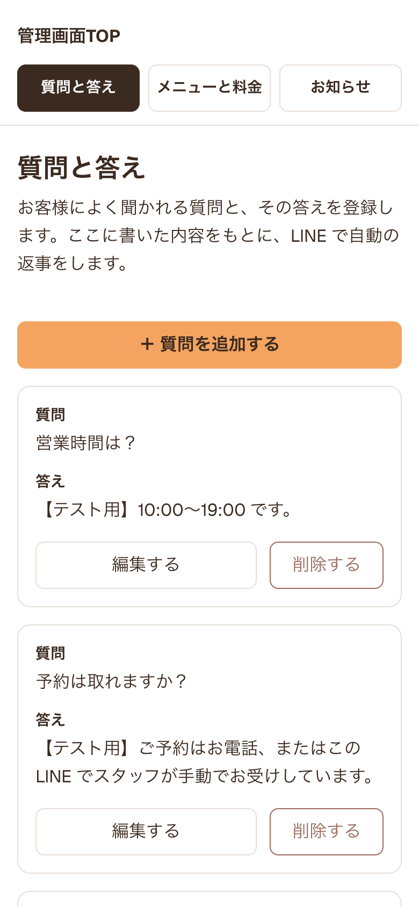
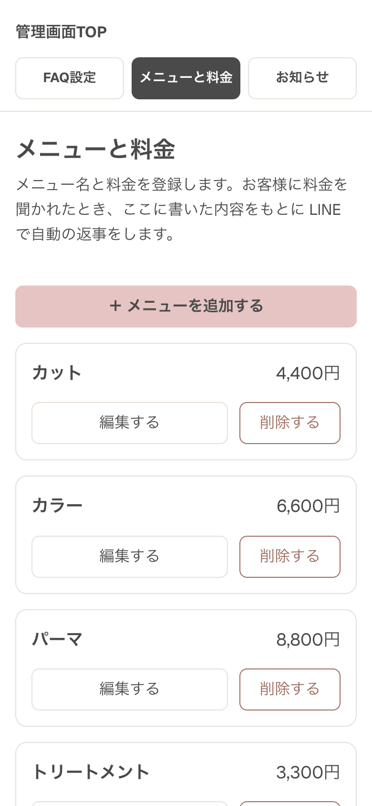
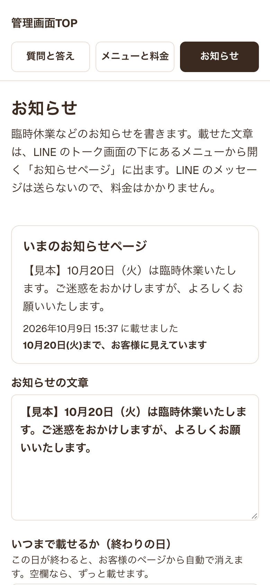
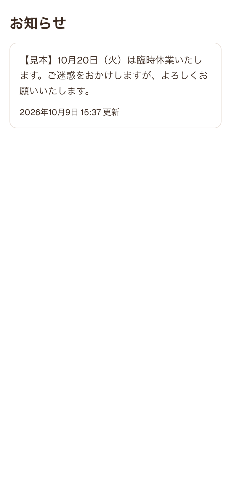
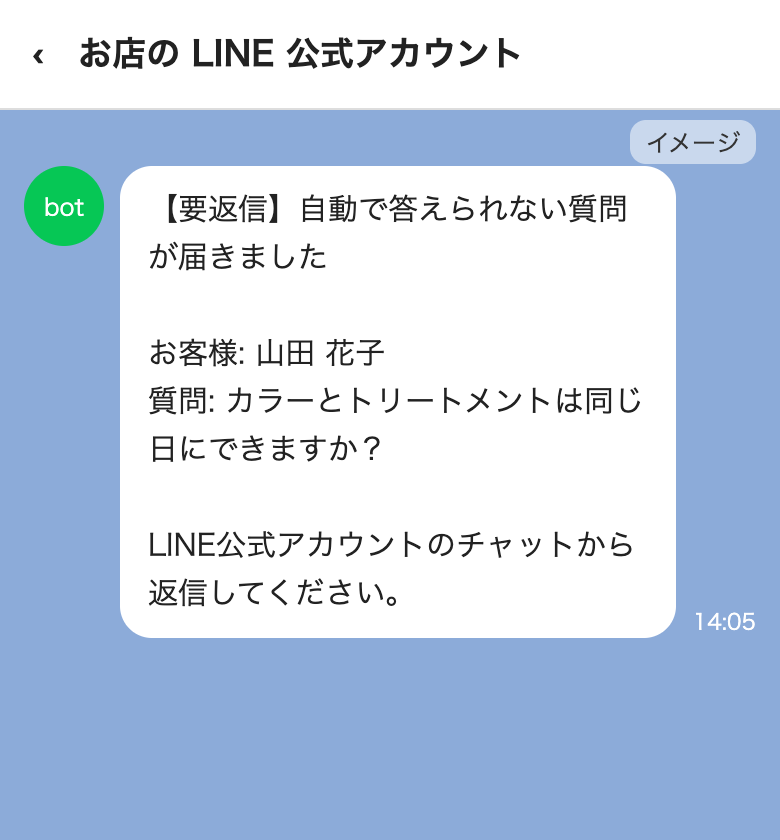

# 運用マニュアル

LINE の自動返事と、管理画面の使い方です。
スマホだけで使えます。パソコンは要りません。

---

## 1. 管理画面を開く

1. スマホのブラウザで、次の URL を開きます。
   https://linebot-ai-eight.vercel.app/admin
2. 「パスワード」の欄に、お渡ししたパスワードを入れます。
3. 「管理画面を開く」を押します。

- 「パスワードが違います」と出たら、もう一度入れ直してください。
- 一度入れると、ブラウザを閉じるまで入れ直さなくて大丈夫です。
- パスワードは、ほかの人に教えないでください。

> この URL をホーム画面に追加しておくと、次から 1 回で開けます。

---

## 2. 開いてすぐの画面「返信が必要な質問」

管理画面を開くと、最初にこの画面が出ます。

- 自動返事が答えられなかった質問が、新しい順に並びます。
- 質問の文と、届いた日時が出ます。
- このとき、お客様には「スタッフが確認してご返信します」と自動で返しています。

### 返信のしかた

1. 「LINE公式アカウント」アプリを開きます。
2. 「チャット」から、そのお客様を選びます。
3. ふつうの LINE と同じように、手で返信します。

「返信が必要な質問はありません」と出ていれば、対応はいりません。

---

## 3. 画面の上のタブ

画面の上に、3 つのタブがあります。
いま開いているタブは、濃い色になります。

| タブ | 直すもの |
| --- | --- |
| 質問と答え | よく聞かれる質問と、その答え |
| メニューと料金 | メニュー名と料金 |
| お知らせ | 臨時休業などのお知らせ |

「管理画面TOP」を押すと、最初の画面に戻ります。

---

## 4. 「質問と答え」「メニューと料金」を直す

どちらも、やり方は同じです。
ここで直した内容は、次の LINE の返事からすぐ使われます。

### 追加する

1. 「＋ 質問を追加する」を押します。メニューのときは「＋ メニューを追加する」を押します。
2. 欄に書きます。
   - 質問と答え：「質問」と「答え」
   - メニューと料金：「メニュー名」と「料金」。例は 4,400円
3. 「保存する」を押します。
4. 「保存しました」と出たら完了です。

### 書き換える

1. 直したいものの「編集する」を押します。
2. 書き直して「保存する」を押します。
3. 「保存しました」と出たら完了です。

### 削除する

1. 消したいものの「削除する」を押します。
2. 「この質問を削除しますか？」と出たら、もう一度「削除する」を押します。メニューのときは「このメニューを削除しますか？」と出ます。
3. 「削除しました」と出たら完了です。

- 削除すると、元に戻せません。
- 途中でやめるときは「やめる」を押します。
- うまくいかないときは、画面に理由が出ます。電波の良い場所で、もう一度試してください。

---

## 5. お知らせを載せる

臨時休業などを、お客様が見るお知らせページに載せます。
お客様は、LINE のトーク画面の下にあるメニューから、このページを開きます。

1. 「お知らせ」タブを押します。
2. 「お知らせの文章」に書きます。
3. 「いつまで載せるか（終わりの日）」を選びます。
   - その日が終わると、お知らせページから自動で消えます。
   - 空欄にすると、ずっと載ります。
4. 「お知らせページに載せる」を押します。
5. 「この内容をお知らせページに載せます。よろしいですか？」と出たら「載せる」を押します。
6. 「お知らせページに載せました」と出たら完了です。

- 新しく載せると、前のお知らせと入れかわります。
- 友だち全員に LINE で送るわけではありません。お客様がページを開いたときに見えます。
- そのため、LINE の料金はかかりません。

---

## 6. bot の返事がおかしいとき

bot は、「質問と答え」と「メニューと料金」に登録した内容だけを見て答えます。
書いていないことは答えず、オーナー様に回します。

- **料金や答えがちがう** → 「メニューと料金」や「質問と答え」を正しく直してください。
- **よく聞かれるのに答えられない** → 「質問と答え」に、その質問と答えを追加してください。

### 答えられない質問が来たとき

- オーナー様の LINE に、【要返信】というメッセージが 1 通届きます。
- お客様の名前と、質問の文が書いてあります。
- 「2. 開いてすぐの画面」と同じやり方で、チャットから返信してください。

